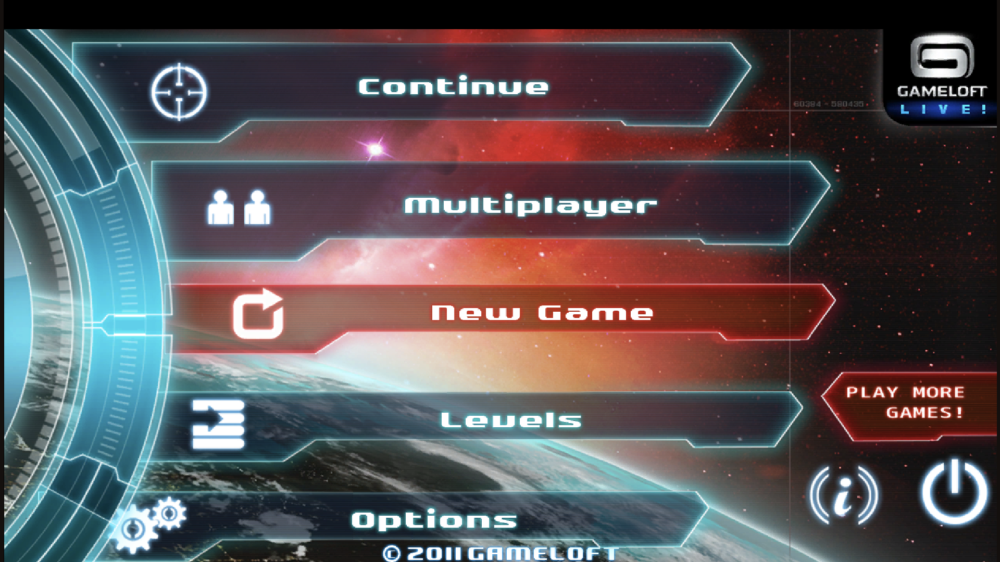
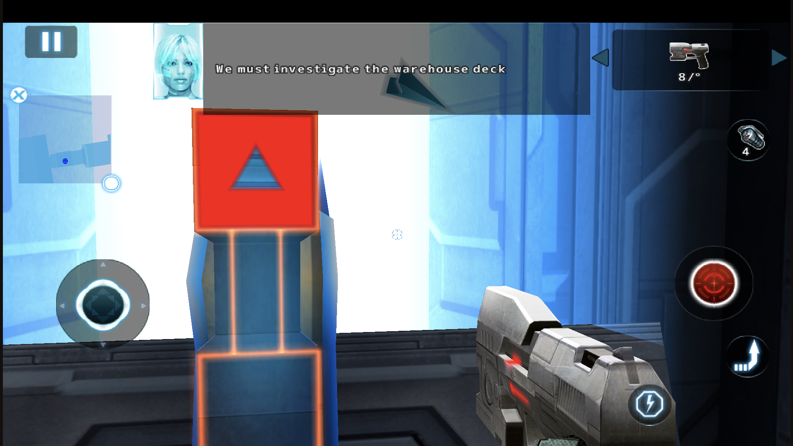

# N.O.V.A. HD Android Reverse Engineering

**An unofficial reverse-engineering and controller-compatibility project for the original N.O.V.A. HD Android game.**

This repository contains a community-made Smali modification of the original Android package. The work focuses on physical-controller input and a first-launch installer for the bundled game data. The released community build identifies itself as version 1.1.5 (version code 115); it is not an official Gameloft 1.1.5 release.

> This is a fan-made reverse-engineering project. It is not affiliated with or endorsed by Gameloft. N.O.V.A. and its original code, art, audio, and other game content remain the property of their respective rights holders.

## Game screenshots

<p align="center">
  
  
</p>

## Latest Android release

[**Download N.O.V.A. HD 1.1.5 Controller Support**](https://github.com/mnkhprre/nova_reborn/releases/tag/v1.1.5-controller.1)

The APK includes the game data. On first launch, it installs the bundled files into `/sdcard/gameloft/games/nova` before starting the game. Keep the app open during extraction. Existing files that are not included in the bundle are preserved.

If Android reports a signature conflict with another installed copy, uninstall that copy before installing this build. Android 14 and newer may block APKs that target very old Android versions; install with adb if needed:

```bash
adb install --bypass-low-target-sdk-block nova-reborn-1.1.5-with-game-data.apk
```

The original native library contains text relocations and is 32-bit (`armeabi-v7a`) only. Raising the target SDK prevents the native library from loading, and 64-bit-only devices are not supported.

### Controller mapping

| Controller input | In-game action |
| --- | --- |
| Left stick | Move |
| Right stick | Camera |
| R2 | Fire |
| R1 | Reload |
| L1 | Previous weapon |
| Y | Next weapon |
| A / B | Jump |
| X | Suit ability |
| Start | Pause |
| D-pad | Navigate menus |

## Build

GitHub Actions builds and signs the APK on pushes to `main`, pull requests, and manual runs. It downloads and validates the game-data archive, compiles the first-launch installer, builds the original Android project with Apktool, and uploads the signed APK as a workflow artifact. The artifact is about 200 MB because the game data is bundled inside it.

The project does not include the original game archive in Git. The workflow downloads it from the Internet Archive; a manual run can override the source with the `game_data_url` input.

For updateable builds, the workflow uses these repository secrets:

| Secret | Purpose |
| --- | --- |
| `ANDROID_KEYSTORE_BASE64` | Base64-encoded signing keystore |
| `ANDROID_KEYSTORE_PASSWORD` | Keystore password |
| `ANDROID_KEY_ALIAS` | Key alias |
| `ANDROID_KEY_PASSWORD` | Optional key password; defaults to the keystore password |

Without these secrets, pull-request builds use a temporary signing key and cannot update a build signed with another key. Never commit signing keys.

## Project layout

- `N.0.V.A. HD 1.1.4 All screens/`: decoded original Android package and community Smali changes
- `Games/nova/`: original game-data tree used by the Android game
- `.github/workflows/build-apk.yml`: automated APK build

All reverse-engineering work is intended for study, compatibility, and preservation.